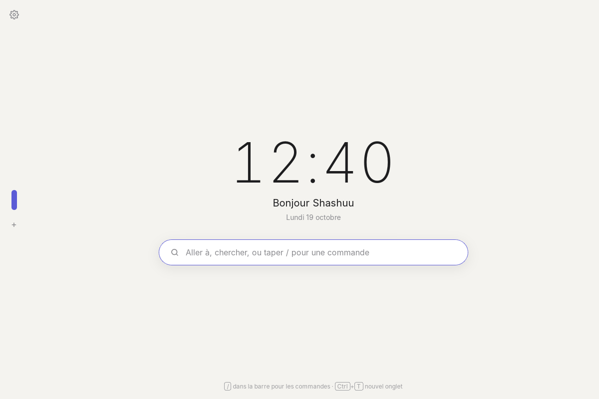

# Feather

Feather est un navigateur léger écrit en Rust. Il n'embarque pas de moteur : il utilise la
webview du système (WebView2 sur Windows, WebKit sur macOS et Linux) grâce à
`tao` (la fenêtre) et `wry` (les webviews). L'exécutable fait environ 1 Mo.




Autres captures : [commandes](captures/commandes.png), [paramètres](captures/parametres.png), [une page ouverte](captures/page.png), [la croix de fermeture](captures/onglets.png), [le son coupé](captures/son.png), [les icônes des sites](captures/icones.png).

## Ce que fait la version 0.1

- **La page prend tout l'écran**, à côté d'une fine colonne à gauche.
- **Page d'accueil** : l'heure, la date, « Bonjour » avec votre prénom, et la
  barre de recherche au milieu. Tapez une adresse (`wikipedia.org`), des mots
  (recherche avec le moteur choisi), ou `/` pour la liste des commandes :
  `/nouveau`, `/fermer`, `/accueil`, `/retour`, `/suivant`, `/actualiser`, `/parametres`.
- **Pastille de recherche** : dès qu'on quitte l'accueil, la recherche se range
  dans un ovale avec une loupe, au-dessus des onglets. Un clic (ou `Ctrl+L`)
  ouvre la barre par-dessus la page ; `Échap` y revient.
- **En haut à gauche** : l'engrenage des paramètres, puis page précédente,
  page suivante et le bouton maison (son adresse se règle dans les paramètres).
- **Onglets en pastilles à gauche** : la longue pastille est l'onglet actif, un
  rond par autre onglet, `+` pour en ouvrir un. Chaque pastille montre l'icône
  du site (un point gris s'il n'en a pas, ou sur l'accueil). Au survol, le nom
  du site s'affiche
  et une petite croix rouge apparaît en haut de la pastille pour la fermer.
  Maintenez le clic sur un onglet pour le monter ou le descendre.
- **Son** : la pastille d'un onglet qui joue une vidéo ou une musique porte un
  petit haut-parleur (barré quand le son est coupé). Un clic sur la pastille
  change toujours d'onglet ; pour couper ou remettre le son, utilisez le petit
  bouton discret qui apparaît en bas de l'onglet au survol, le clic droit sur
  l'onglet, ou `Ctrl+M`.
- **Paramètres** (engrenage en haut à gauche) : prénom, moteur de recherche
  (DuckDuckGo, Qwant, Ecosia, Google, Bing), adresse du bouton maison (ouverte
  aussi au démarrage ; les nouveaux onglets ouvrent l'accueil Feather), thème clair, sombre
  ou automatique. Ils sont enregistrés dans `parametres.json`, dans le dossier
  de configuration du système (`%APPDATA%\Feather\Feather\config` sur Windows).
- **Favoris, historique, téléchargements** (nouveau en 0.2) : trois boutons sous
  la maison (tout à droite quand la barre est en haut) ouvrent chacun son
  panneau, avec une recherche. Sous macOS et Windows, les panneaux flottent
  par-dessus la page, qui reste visible. L'étoile (dans la barre de recherche, ou dans l'onglet
  actif quand la barre est en haut) ou `Ctrl+D` ajoute la page aux favoris, qui
  s'affichent aussi sur l'accueil. L'historique est rangé par jour et oublié
  après la durée choisie dans les paramètres. Les fichiers téléchargés vont
  dans le dossier Téléchargements, ou dans celui indiqué dans les paramètres.
- **Au démarrage** : ouvrir l'accueil, ou rouvrir les onglets de la dernière fois.
  Historique, favoris et onglets sont enregistrés dans `historique.json`,
  `favoris.json` et `session.json`, à côté de `parametres.json`, et restent sur
  l'ordinateur.
- **Nouveau en 0.3** :
  - **Chercher dans la page** (`Ctrl+F`) : un bandeau en bas de la fenêtre,
    `Entrée` / `Maj+Entrée` pour l'occurrence suivante ou précédente.
  - **Zoom retenu par site** (`Ctrl++`, `Ctrl+-`, `Ctrl+0`), rangé dans `sites.json`.
  - **Rouvrir l'onglet fermé** (`Ctrl+Maj+T`, les dix derniers) et **imprimer** (`Ctrl+P`).
  - **Cadenas** dans la barre : chiffré (https) ou non (http, signalé en rouge
    sur la pastille de recherche et dans l'onglet).
  - **Suggestions** sous la barre : favoris puis historique, au fil de la frappe.
  - **Menu des liens** (clic droit) : nouvel onglet, arrière-plan, onglet privé,
    copier l'adresse. `Maj+clic droit` garde le menu habituel.
  - **Onglets privés** (`Ctrl+Maj+N`, ou `/prive`) : pastille en pointillés,
    rien dans l'historique ni sur le disque ; chaque onglet privé a sa propre
    session, oubliée à sa fermeture.
  - **Téléchargements** : progression, vitesse et bouton Annuler.
  - **Veille des onglets** : un onglet caché depuis longtemps (30 minutes par
    défaut, réglable) libère sa mémoire et se recharge au clic. Au démarrage,
    seuls les onglets affichés sont chargés. Aussi : clic droit → Veille.
  - **Blocage des traqueurs** (macOS et Windows) : une liste courte de domaines
    de mesure d'audience et de publicité, désactivable dans les paramètres.
  - **Autorisations par site** : caméra, micro, position, notifications,
    partage d'écran, presse-papiers. Feather demande dans le bandeau du bas, et
    retient le choix si on le souhaite (liste et « Oublier » dans les paramètres).
  - **Commandes natives** dans la barre : `/calcul (12+3)*7`,
    `/convertir 5 km en miles`, `/minuteur 10 min thé`, `/note acheter du pain`,
    `/notes` (et `/notes effacer`). L'aperçu s'affiche pendant la frappe.
  - **Poids des onglets** : un anneau orange (chargé) ou rouge (lourd) autour de
    la pastille ; la bulle donne la mémoire et le processeur. Un onglet caché et
    lourd s'endort au bout de cinq minutes.
  - **Barre latérale à la largeur voulue** : à gauche ou à droite, on tire sur
    son bord (côté page) pour l'élargir ; le titre des pages apparaît peu à peu
    à côté des pastilles. Double-clic sur le bord : taille d'origine.
  - **Recherche dans le texte des pages** : l'historique retrouve une page par
    un mot de son contenu, avec un extrait (`contenu.json`, désactivable).
- **Nouveau en 0.3.4** (mémoire) :
  - **Veille douce** (Windows) : un onglet caché depuis 2 minutes demande au
    moteur de libérer sa mémoire, et il est gelé après 10 minutes. Il revient
    tout de suite, sans recharger la page (position et formulaires gardés).
    Les onglets privés en profitent aussi. La veille complète (page détruite)
    reste réglable dans les paramètres.
  - **Recherche dans le texte des pages plus sobre** : la version normalisée
    du texte n'est calculée qu'à la première recherche, et prend quatre fois
    moins de place (jusqu'à environ 30 Mo économisés avec 2 000 pages).
  - **Adresses au lancement** : `feather https://exemple.fr https://autre.fr`
    ouvre chaque adresse dans un onglet.
  - **Banc de mesure de la mémoire** : voir « Mesurer la mémoire » plus bas.
- **Nouveau en 0.3.5** :
  - **Mémoire des onglets** (bouton sous les téléchargements, `Maj+Échap` ou
    `/memoire`) : chaque onglet avec sa mémoire, son processeur et son état
    (affiché, allégé, gelé, en veille), le total, et des boutons pour réveiller,
    mettre en veille ou fermer. En bas : « Endormir les onglets cachés ».
  - **Mode économie** (paramètres, ou `/economie`) : veille après 5 minutes au
    plus, vidéos muettes des onglets cachés en pause (le son qu'on écoute
    continue), vidéos qui démarrent seules bloquées jusqu'au premier clic sur la
    page, traqueurs bloqués. Une petite feuille verte le signale.
  - **Pages d'erreur Feather** (Windows, macOS) : pas de connexion, adresse
    introuvable (avec une recherche proposée), site qui ne répond pas,
    certificat invalide, site trop lent. « Réessayer », et rechargement tout
    seul quand la connexion revient.
  - **Fiche du site** (clic sur le cadenas de la barre, menu de l'onglet ou
    `/site`) : connexion chiffrée ou non, autorisations retenues pour ce site
    (à changer ou oublier), zoom, blocage des traqueurs, et « Effacer les
    données de ce site » (cookies et stockage).
- **Nouveau en 0.3.6** :
  - **Onglets épinglés** (clic droit sur l'onglet → Épingler) : de petits
    carrés en tête de liste, gardés d'une session à l'autre et ouverts même
    quand Feather démarre sur l'accueil (en veille, sans mémoire). `Ctrl+W` et
    la croix ne les ferment pas : clic droit → Fermer.
  - **Groupes d'onglets** (clic droit → Groupe) : une étiquette de couleur
    au-dessus des onglets du groupe, avec leur nombre (et le nom quand la barre
    est élargie ou en haut). Un clic replie le groupe : ses onglets cachés se
    mettent en veille et rendent leur mémoire. Clic droit sur l'étiquette :
    renommer, dégrouper, fermer le groupe.
  - **Mode lecture** (bouton livre, menu de l'onglet ou `/lecture`) : le texte
    et les images de l'article, sans menus ni publicités, avec la taille du
    texte, la police et le thème (clair, sépia, nuit) à choisir. Le bouton
    n'apparaît que sur les pages qui ressemblent à un article. L'extraction
    reprend Readability de Firefox, chargé seulement au clic ; la page
    d'origine est quittée et sa mémoire rendue.
  - **Importer des favoris** (Paramètres → Importer des favoris…) : depuis
    Chrome, Edge, Brave ou Chromium installés sur l'ordinateur, ou depuis un
    fichier HTML exporté par Firefox, Safari ou un autre navigateur. Les favoris
    déjà présents ne sont pas ajoutés deux fois.
  - **Capture de la page** (`Ctrl+Maj+S` ou `/capture`) : une image PNG de la
    partie visible, rangée dans le dossier des téléchargements et ajoutée à leur
    liste. `/capture copier` la met dans le presse-papiers.
- **Nouveau en 0.3.7** :
  - Un onglet mis en veille se recharge bien quand on y revient (il
    s'ouvrait sur une page blanche).
  - Bouton « Actualiser » entre les flèches et l'accueil.
  - Menu du clic droit sur un onglet plus grand, ouvert à droite du curseur,
    avec « Réglages du site web ».
  - Barre latérale élargie : 300 px au plus.
- **Nouveau en 0.3.8** :
  - **Bloqueur de publicités** (Paramètres → Vie privée et sites) : les listes
    publiques EasyList, EasyPrivacy et Liste FR, téléchargées au premier
    lancement puis chaque semaine (« Mettre à jour » pour le faire tout de
    suite). Les requêtes vers environ 100 000 domaines de publicité et de suivi
    sont refusées, et les encarts publicitaires masqués. La fiche du site
    permet de couper le bloqueur sur un site (la page se recharge).
  - **Paramètres rangés par catégories** (Général, Apparence, Recherche,
    Onglets et mémoire, Vie privée et sites, Historique et données,
    Téléchargements, Raccourcis clavier, À propos et mise à jour), avec une
    recherche (« veille », « cookies »…). Chaque changement est enregistré tout
    de suite : plus de bouton « Enregistrer ». `/parametres veille` ouvre les
    paramètres déjà filtrés ; la fiche du site mène à « Vie privée et sites ».
- **Depuis la 0.3.8 (pas encore publié)** : refonte « Plume ».
  - Fond papier, pastilles carrées arrondies (l'initiale du site quand il n'a
    pas d'icône), nouvelle page d'accueil : date et heure, salutation, favoris
    en tuiles et « Reprendre » (les dernières pages visitées).
  - **Quatre styles pour la barre latérale** (Paramètres → Apparence) :
    *Palette* (par défaut : un clic sur l'onglet actif ouvre l'adresse et les
    actions de la page : copier, favori, lecture, capture, réglages du site,
    imprimer), *Bandeau* (l'adresse toujours au-dessus de la page), *Au survol*
    (la barre s'ouvre par-dessus la page quand la souris approche ; pas sous
    Linux) et *Barre large* (adresse et titres en permanence).
  - **Mode concentration** (`Ctrl+Maj+F` ou `/concentration`) : la barre se
    réduit à un fil, la page prend presque toute la fenêtre.
  - Paramètres plus grands, avec une **vue d'ensemble** (une carte par
    catégorie et quelques réglages rapides) et des aperçus visuels pour le
    thème, la position et le style de la barre, plus un curseur de largeur.

Raccourcis : `Ctrl+L` rechercher, `Ctrl+T` nouvel onglet, `Ctrl+W` fermer,
`Ctrl+Tab` / `Ctrl+Maj+Tab` changer d'onglet, `Alt+←` / `Alt+→` page précédente
ou suivante, `F5` ou `Ctrl+R` actualiser, `Ctrl+M` couper le son de l'onglet,
`Ctrl+D` ajouter aux favoris, `Ctrl+,` paramètres, `Ctrl+F` chercher dans la
page, `Ctrl++` / `Ctrl+-` / `Ctrl+0` zoom, `Ctrl+Maj+T` rouvrir l'onglet fermé,
`Ctrl+Maj+N` onglet privé, `Ctrl+P` imprimer, `Maj+Échap` mémoire des onglets,
`Ctrl+Maj+S` capture de la page, `Ctrl+Maj+F` mode concentration.

## Lancer le navigateur

1. Installez Rust : <https://rustup.rs> (sur Windows, acceptez l'installation
   des outils Visual Studio C++ proposée par rustup).
2. Dans ce dossier, lancez :

   ```
   cargo run --release
   ```

   L'exécutable se trouve ensuite dans `target/release/` (`feather.exe` sur Windows).

Selon le système :

- **Windows 10 et 11** : rien d'autre à installer, WebView2 est déjà présent.
- **macOS** : rien d'autre à installer.
- **Linux (Debian, Ubuntu)** : installez d'abord
  `sudo apt install libwebkit2gtk-4.1-dev libgtk-3-dev`.

Pour lancer les tests : `cargo test`.

## Organisation du code

| Fichier | Rôle |
| --- | --- |
| `src/main.rs` | Création de la fenêtre, boucle d'événements, réaction aux messages. |
| `src/tab_manager.rs` | Les onglets : une webview par onglet, ouverture, changement, fermeture. |
| `src/settings.rs` | Lecture et écriture des paramètres en JSON (serde). |
| `src/ui.rs` | Messages échangés avec l'interface et les pages, placement des zones, page d'accueil. |
| `src/network.rs` | Décide si la saisie est une adresse ou une recherche. |
| `src/library.rs` | Historique, favoris et onglets de la dernière session (fichiers JSON). |
| `src/downloads.rs` | Où ranger les téléchargements, leur progression, les montrer dans le dossier. |
| `src/features.rs` | Zoom, recherche dans la page, suggestions, commandes, autorisations, veille, téléchargements. |
| `src/commands.rs` | Commandes natives de la barre (calcul, conversion, minuteur, notes). |
| `src/fulltext.rs` | Texte des pages visitées, pour chercher dans l'historique. |
| `src/sitedata.rs` | Zoom et autorisations retenus par site (`sites.json`). |
| `src/trackers.rs` | Liste des traqueurs et blocage (WebKit sous macOS, WebView2 sous Windows). |
| `src/adblock.rs` | Bloqueur de publicités : téléchargement et lecture des listes EasyList, domaines bloqués, encarts masqués. |
| `src/weight.rs` | Poids d'un onglet (mémoire, processeur, page ralentie). |
| `src/softsleep.rs` | Veille douce des onglets cachés (Windows : mémoire réduite, puis page gelée). |
| `src/errorpage.rs` | Pages d'erreur Feather et détection des chargements en échec. |
| `src/siteclear.rs` | « Effacer les données de ce site » (fiche du site). |
| `src/reader.rs` | Mode lecture : extraction de l'article et page `navigateur://lecture/`. |
| `src/import.rs` | Import des favoris (Chrome, Edge, Brave, fichier HTML). |
| `src/capture.rs` | Capture de la page visible (WebView2, WebKit). |
| `outils/banc-memoire.*` | Banc de mesure de la mémoire (macOS et Windows). |
| `src/layers.rs` | Panneaux par-dessus la page : l'interface passe devant, découpée à leur forme. |
| `assets/page.js` | Script injecté dans chaque page : raccourcis, son, recherche, menu des liens, autorisations. |
| `assets/chrome.html` | L'interface (pastilles, barre, commandes, paramètres) en HTML/CSS. |
| `assets/home.html` | La page d'accueil. |
| `assets/error.html` | Le modèle des pages d'erreur. |
| `assets/reader.html` | Le modèle de la page de lecture. |
| `assets/vendor/Readability.js` | Readability de Mozilla 0.6.0 (licence Apache 2.0, voir `Readability-LICENSE.md`). |

L'interface est une webview placée sous les pages : elle dessine la colonne de
gauche, et la page de l'onglet actif occupe le reste. Quand un panneau s'ouvre
(barre de recherche, paramètres, favoris…), l'interface passe devant la page
(macOS, Windows ; voir `layers.rs`) ou la masque (Linux). Un nouveau panneau
n'a qu'à porter la classe `card` et ouvrir un mode avec `setMode`.
L'interface et les pages parlent au code Rust par des messages JSON ; Rust
renvoie l'état (liste des onglets, paramètres) à l'interface.

**Mémoire** : le gestionnaire d'onglets possède les webviews. Fermer un onglet
le retire de la liste, ce qui détruit sa webview et libère sa mémoire. Il n'y a
ni `Rc` ni `RefCell` : les rappels des webviews ne gardent que le numéro de
leur onglet et envoient des messages.

## Limites connues

- Navigation privée : des onglets privés dans la même fenêtre, pas une fenêtre à part.
- Téléchargements : la progression est mesurée sur le fichier en cours
  d'écriture (le moteur ne la donne pas). « Annuler » ne peut pas arrêter le
  transfert : Feather supprime le fichier tout de suite, puis de nouveau quand
  le moteur a fini. Pas de choix du dossier à chaque fichier, et la liste se
  vide au redémarrage.
- Blocage des traqueurs : pas sous Linux. Sous Windows, les requêtes bloquées
  reçoivent une réponse 403.
- Bloqueur de publicités : seules les règles sur des domaines entiers et les
  encarts simples (`##.pub`) sont appliqués ; les règles sur un chemin, les
  scripts de remplacement et les pseudo-classes propres aux bloqueurs sont
  ignorés. Pas d'effet dans les cadres (iframe) pour le masquage, ni sous
  Linux. Les listes ne sont pas incluses dans Feather : elles sont téléchargées
  depuis le dépôt GitHub d'EasyList (licence GPLv3 ou CC BY-SA 3.0, au choix).
- Poids des onglets : mémoire et processeur mesurés par le système sous macOS
  seulement ; ailleurs, mémoire du JavaScript (Windows) et lenteur de la page.
- Autorisations : Feather répond avant le moteur pour les fonctions que la page
  appelle directement ; une demande faite depuis un cadre (iframe) reste
  traitée par le moteur.
- Suggestions sous la barre : seulement avec la barre à gauche ou à droite.
- Panneaux par-dessus la page : pas sous Linux, où la page est cachée pendant
  qu'un panneau est ouvert.
- Icônes : Feather télécharge l'icône que le site indique lui-même (ou
  `/favicon.ico`), jamais via un service tiers, sans envoyer l'adresse de la
  page d'origine. Elle n'est gardée que pour les onglets ouverts.
- Sur Linux, seul X11 a été essayé (pas Wayland). Pas de pages d'erreur Feather
  ni d'effacement des données d'un site sous Linux.
- Pages d'erreur : pas de « Continuer quand même » sur un certificat invalide.
  Sous Windows, « Précédent » depuis une page d'erreur recule de deux pages
  (le moteur garde la page en échec juste avant).
- Capture : seulement la partie visible de la page (pas la page entière), et
  pas sous Linux. Sous Windows, l'image copiée est au format PNG : la plupart
  des logiciels la collent (Word, navigateurs, messageries), pas Paint.
- Import : les favoris seulement (pas l'historique ni les mots de passe), et
  depuis le profil par défaut de chaque navigateur. Firefox et Safari passent
  par leur export HTML.
- Mode lecture : l'article est gardé en mémoire le temps de la lecture ;
  après un redémarrage, la page de lecture renvoie vers la page d'origine.
- L'icône de son repère les balises vidéo et audio de la page, pas les sons
  produits par Web Audio ni ceux des vidéos intégrées dans un cadre (iframe).

## Mesurer la mémoire

Le banc de mesure lance Feather deux fois (accueil seul, puis cinq sites
ouverts) et additionne la mémoire de Feather et des processus du moteur :

- macOS : `outils/banc-memoire.sh target/release/feather` (sans Safari ni Mail
  ouverts, qui partagent les processus WebKit) ;
- Windows : `outils\banc-memoire.ps1 -Programme target\release\feather.exe`.

Le workflow GitHub le lance après chaque compilation et affiche le tableau dans
le résumé de l'exécution, pour repérer une version qui consomme plus que la
précédente. Les chiffres varient d'une exécution à l'autre selon le contenu des
sites : comparez des ordres de grandeur, pas des mégaoctets près.

## Télécharger sans installer Rust

Le dépôt GitHub construit automatiquement un `.exe` (Windows) et un `.dmg`
(macOS, Apple Silicon et Intel) : onglet **Actions** puis la dernière
exécution, section *Artifacts*. Les versions étiquetées (`v0.1.0`, etc.) sont
publiées dans l'onglet **Releases**.

Les programmes ne sont pas signés : Windows peut afficher un avertissement
SmartScreen (« Informations complémentaires » puis « Exécuter quand même »), et
sur macOS il faut faire clic droit sur l'application puis « Ouvrir » la première fois.

## Mise à jour intégrée

Dans les paramètres, la section « Mise à jour » montre la version actuelle et,
s'il y en a une, la nouvelle. Feather cherche au démarrage (désactivable) la
dernière release du dépôt public `Shaashuu/feather-releases`. Le bouton
« Télécharger » récupère le fichier de votre système, vérifie son empreinte
SHA-256, puis remplace le programme ; le bouton devient alors
« Redémarrer pour mettre à jour ». Rien ne change tant que vous n'avez pas cliqué.

Le workflow `build.yml` publie la release dans ce dépôt si le secret
`RELEASES_TOKEN` (jeton avec accès en écriture au contenu de `feather-releases`)
existe dans le dépôt du code. Les fichiers ne sont pas signés : la mise à jour
automatique n'enlève pas l'avertissement de Windows ou de macOS à la première installation.
